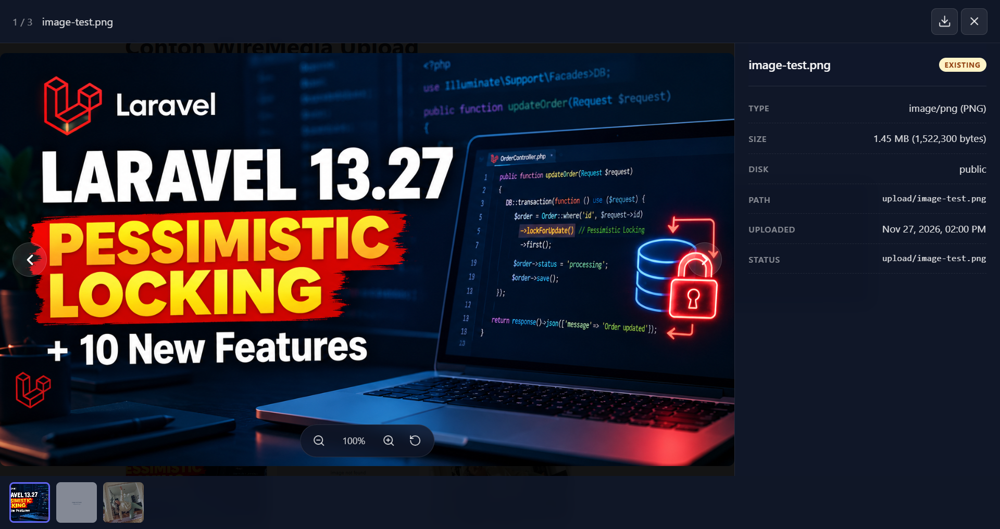
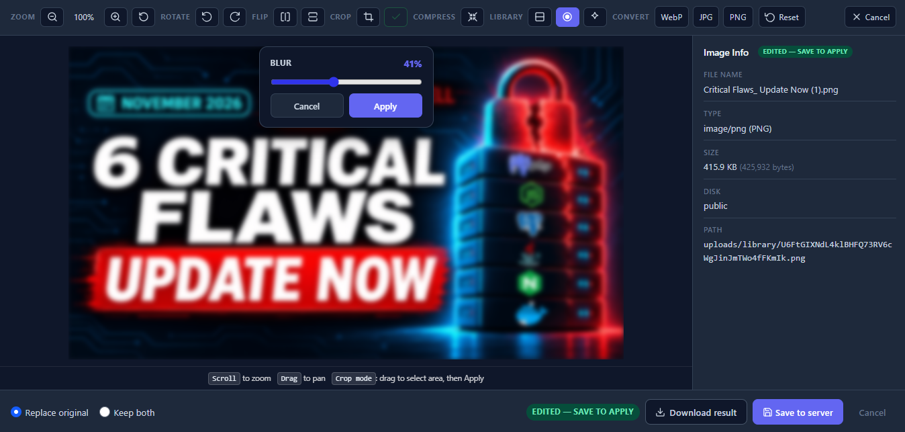

# WireMedia

[](https://packagist.org/packages/developerawam/wire-media)
[](https://laravel.com)
[](https://livewire.laravel.com)
[](LICENSE.md)

**Premium Livewire media upload & image editor for Laravel 12/13.**  
Upload, crop, zoom, rotate, flip, **fullscreen split file viewer** (preview + details side-by-side) and **fullscreen image editor with live info** — zero external JS dependencies.

> **Works out of the box with Livewire v3 AND v4.** Component assets (styles + scripts) are injected via Livewire's `@assets` mechanism, so they are loaded once per page, deduplicated, and **never broken by Livewire's DOM morphing after an upload**.

---

## ✅ Requirements

| Dependency         | Version                                 |
| ------------------ | --------------------------------------- |
| PHP                | ^8.2 - ^8.3                             |
| Laravel            | ^12.0 \|\| ^13.0                        |
| Livewire           | ^3.0 or ^4.0                            |
| Alpine.js          | ^3.x                                    |
| Intervention Image | ^4.0 (optional, for library & compress) |

---

## 📥 Installation

```bash
composer require developerawam/wire-media
```

Ensure your layout includes Alpine.js and Livewire scripts:

```html
<script defer src="https://unpkg.com/alpinejs@3.x.x/dist/cdn.min.js"></script>
@livewireStyles @livewireScripts
```

> **Large images:** If you edit large photos (3-4 MB canvas `dataUrl`), increase Livewire payload limit in `config/livewire.php`:
>
> ```php
> 'payload' => ['max_size' => 5 * 1024 * 1024, // 5MB
> ```

### Publish (optional)

```bash
# Config
php artisan vendor:publish --tag=wire-media-config

# Views (to customise)
php artisan vendor:publish --tag=wire-media-views

# Language files
php artisan vendor:publish --tag=wire-media-lang

# JS assets to public/
php artisan vendor:publish --tag=wire-media-assets
```

> **Note:** The published config (`config/wire-media.php`) sets the **defaults** for `disk`, `directory`, `max-size-mb`, `max-files`, accepted types and UI options. Any prop passed to `<livewire:wire-media>` overrides its config default; props left unset fall back to the config value.

### Optional: Image Library Mode

By default WireMedia stores images **as uploaded**. You can optionally enable automatic image processing (resize, format conversion, optimisation & thumbnail generation) powered by [Intervention Image](https://intervention.io):

```bash
composer require intervention/image
```

Then set the `use_image_library` config to `true`:

```env
WIRE_MEDIA_USE_IMAGE_LIBRARY=true
```

| Config key                                  | Default     | Description                                |
| ------------------------------------------- | ----------- | ------------------------------------------ |
| `WIRE_MEDIA_IMAGE_DRIVER`                   | `gd`        | `gd` or `imagick`                          |
| `WIRE_MEDIA_IMAGE_MAX_WIDTH` / `MAX_HEIGHT` | `1920/1080` | Scale down larger images to this bound     |
| `WIRE_MEDIA_IMAGE_QUALITY`                  | `85`        | Output quality (JPEG/WebP, 1–100)          |
| `WIRE_MEDIA_IMAGE_FORMAT`                   | `webp`      | Output format: `webp`, `jpg`, `png`, `gif` |

The processor automatically:

- **Resizes** oversized images down (`scaleDown`, never upscales)
- **Converts** to the target format with quality compression
- **Generates a WebP thumbnail variant** (`-thumb`, 400×400, used in the grid)
- Applies to **uploads and editor saves**; thumbnails are removed together with their original file

When image-library mode is on, the **image editor toolbar** additionally exposes server-side
Intervention transforms: **grayscale**, **blur**, and **sharpen** open a 0–100% strength slider
with **Apply** / **Cancel** — the canvas previews the effect live, Apply bakes it into the image
and Cancel reverts — plus one-click **convert** (WebP / JPG / PNG). Edits are re-encoded
server-side so they stay optimised.

> **Fallback:** when the flag is off, or `intervention/image` is not installed,
> WireMedia silently behaves like the default mode — nothing breaks.

### Optional: Auto Compress

Lossless re-encode without resize, keep original format at high quality (`92`):

```env
WIRE_MEDIA_AUTO_COMPRESS=true
```

When `:auto-compress="true"` (or config), **upload** is automatically compressed (same mime, no resize) **only if smaller** — prevents `200KB → 2MB` inflation. Requires `intervention/image`. Library mode has priority when both are enabled and `auto-compress` is true (`resize+webp`).

| Prop                       | Config             | Env                           |
| -------------------------- | ------------------ | ----------------------------- |
| `:auto-compress="true"`    | `auto_compress`    | `WIRE_MEDIA_AUTO_COMPRESS`    |
| `:ui-auto-compress="true"` | `ui_auto_compress` | `WIRE_MEDIA_UI_AUTO_COMPRESS` |

`ui-auto-compress` shows a **Compress slider 0–100%** in the editor toolbar (same UX as grayscale). `Apply` bakes via server `compress` transform if payload `<900KB` else client `canvas.toDataURL(mime, quality)` (with `PNG→JPEG` fallback at `<100%`). No visual filter preview — quality only affects export size.

---

## 🚀 Basic Usage

```blade
<livewire:wire-media />
```

---

## 🎛️ All Props

| Prop                  | Type     | Default     | Description                                                       |
| --------------------- | -------- | ----------- | ----------------------------------------------------------------- |
| `multiple`            | `bool`   | `false`     | Allow multiple file selection                                     |
| `accepted-extensions` | `array`  | `[]`        | Allowed extensions e.g. `['jpg','png','pdf']`                     |
| `accepted-mime-types` | `array`  | `[]`        | Allowed MIME types e.g. `['image/*','application/pdf']`           |
| `accept-attribute`    | `string` | `''`        | Raw HTML `accept` attribute string                                |
| `max-size-mb`         | `float`  | `2.0`       | Max file size in **megabytes**                                    |
| `max-files`           | `int`    | `0`         | Max files when multiple (0 = unlimited)                           |
| `disk`                | `string` | `'public'`  | Laravel filesystem disk                                           |
| `directory`           | `string` | `'uploads'` | Sub-directory on disk                                             |
| `show-preview`        | `bool`   | `true`      | Show image thumbnails in grid                                     |
| `show-list`           | `bool`   | `true`      | Show uploaded file grid                                           |
| `label`               | `string` | `''`        | Label above dropzone                                              |
| `help-text`           | `string` | `''`        | Help text below component                                         |
| `existing-files`      | `mixed`  | `null`      | Pre-load files (array of paths, metadata, or Model)               |
| `model-attribute`     | `string` | `null`      | Model column when `existing-files` is an Eloquent Model           |
| `dark-mode`           | `bool`   | `false`     | Force dark mode (also auto-detects OS preference)                 |
| `use-image-library`   | `bool`   | `false`     | Enable image processing for this instance (requires Intervention) |
| `auto-compress`       | `bool`   | `false`     | Lossless auto compress on upload (same mime, q92, no resize)      |
| `ui-auto-compress`    | `bool`   | `false`     | Show editor Compress slider 0–100%                                |
| `preview-only`        | `bool`   | `false`     | Read-only: hide dropzone/edit/delete, only preview                |

**Auto-compress gating:**

- `previewOnly=false` + `autoCompress=false` + `uiAutoCompress=false` → **no auto compress** (ori stored)
- `autoCompress=true` → upload compressed (library `webp` if `useImageLibrary`, else lossless)
- `uiAutoCompress=true` only → upload ori, compress via `Edit → slider → Apply → Save`
- both `true` → upload compressed + UI available

---

## 🌟 Features

### Upload

- Drag & drop or click to browse
- Single or multiple files
- Extension, MIME type & file size validation
- Max file count enforcement
- `previewOnly` blocks `updatedFiles/removeFile/clearAll/openEditor`

### Preview-Only Mode

Read-only gallery from existing files only:

```blade
<livewire:wire-media :preview-only="true" :existing-files="['upload/photo.jpg', 'https://cdn.example.com/img.jpg']" :multiple="true" />
```

- Hides dropzone, edit, delete, clearAll, editor
- Still shows grid + lightbox (download + zoom, edit hidden)
- `existing-files` supports: **Storage** (`uploads/gallery/x.jpg`), **public/** dynamic folder (`upload/`, `custom_folder/` via `public_path()` → `asset()`), **external URL** (`https://...`, S3 `https://bucket.s3.amazonaws.com/...`), **missing** → `data:image/svg+xml` placeholder “Image not found”.

### Image Viewer — Fullscreen Split View

Click **any card thumbnail** (image, PDF or document) or the **↔ fullscreen button** (images).

The viewer opens as a **fullscreen modal split into two panes**:



**Left pane — preview** (adapts to file type):

- **Image** → `` with loading spinner (hidden for docs)
- **PDF** → inline `<iframe>` embed (`#toolbar=0&navpanes=0`)
- **Other documents** → extension badge + "no preview" placeholder

**Right pane — details** (auto-fills on every slide):

- File name + **status badge** (`New` / `Existing` / `Missing`)
- **Type** (MIME + extension)
- **Size** (human readable + raw bytes)
- **Disk**
- **Path** (monospace)
- **Uploaded** date (localised)
- **Status**

**Navigation & controls:**

- Prev / Next (`←` `→` keyboard, buttons, swipe on mobile)
- Scrollable thumbnail strip (images show thumbnails; documents show extension badges)
- Zoom (buttons, scroll wheel, `+` / `-` / `0` — images only, hidden when `previewOnly`)
- **Download** in header
- **Edit** button in header (images only → opens the fullscreen editor, hidden when `previewOnly`)
- `Esc` to close

> The details panel is a dedicated component with **sticky header**, scrollable list, and a responsive layout: on narrow screens (<768px) the panes **stack vertically** (preview on top, details below).

### Image Editor — Fullscreen Split Stage

Click ✏️ (on an image card, in the viewer, or in the detail panel) to open the editor.

The editor opens as a **fullscreen overlay** (`position: fixed`, covers the viewport) with **split stage**: canvas left + live info right:

 [hint: Scroll/Drag/Crop overlay at canvas bottom]

| Action      | How                                                  |
| ----------- | ---------------------------------------------------- |
| Zoom in/out | Scroll wheel or toolbar buttons                      |
| Pan         | Drag when not in crop mode                           |
| Rotate      | CW/CCW 90° buttons                                   |
| Flip        | Horizontal or vertical buttons                       |
| Crop        | Enable → drag to select → Apply ✓                    |
| Compress    | Slider 0–100% → Apply (PNG→JPEG at <100%)            |
| Library     | Grayscale/Blur/Sharpen slider + Convert WebP/JPG/PNG |
| Reset       | Reset all transforms (undoes crops/convert/compress) |

- **Close ✕** button pinned to the top-right of the toolbar
- **Cancel** also available in the save bar
- **Live info** on the right updates instantly on `convert/compress/crop` (type/size delta `↓ smaller / ↑ larger`) and shows `Compressed / Converted / Cropped / Edited — Save to apply` badge + pulse on `Save to server` when `hasChanges`.
- **Loading** overlay `Converting…` + spinner on `Apply` and `Convert` (server `libraryTransformDataUrl` or client `toDataURL`).
- Save options: **Replace original** (dispatches `file-removed` for old + `image-processed`), **Keep both**, or **Download locally**

### Detail Panel (fallback, non-image)

For non-image files in the standard view, opening the card previously used an inline detail panel. With the fullscreen split viewer this is no longer needed — every file type now opens the unified fullscreen viewer instead.

### Edit Mode

Pre-load existing files:

```blade
{{-- From path array (storage, public, or external) --}}
<livewire:wire-media
    :existing-files="['uploads/photo.jpg', 'upload/public-img.png', 'https://cdn.example.com/img.jpg']"
    :multiple="true"
/>

{{-- From Eloquent model --}}
<livewire:wire-media
    :existing-files="$user"
    model-attribute="avatar"
/>

{{-- Preview only (no upload) --}}
<livewire:wire-media :preview-only="true" :existing-files="['upload/gallery.jpg']" />
```

### Dark Mode

Auto-detects OS preference. Force with `:dark-mode="true"`.

---

## 📸 Usage Examples

```blade
{{-- Image gallery with editor + auto compress --}}
<livewire:wire-media
    :multiple="true"
    :accepted-mime-types="['image/*']"
    :max-size-mb="10"
    :max-files="20"
    :auto-compress="true"
    :ui-auto-compress="true"
    label="Photo Gallery"
    :dark-mode="true"
/>

{{-- Preview only gallery (existing public/S3) --}}
<livewire:wire-media
    :preview-only="true"
    :existing-files="['upload/photo.jpg', 'https://bucket.s3.amazonaws.com/photo.jpg']"
    :multiple="true"
/>

{{-- Document attachments --}}
<livewire:wire-media
    :multiple="true"
    :accepted-extensions="['pdf','docx','xlsx']"
    :max-size-mb="25"
    label="Attachments"
/>

{{-- S3 upload --}}
<livewire:wire-media
    disk="s3"
    directory="products/images"
    :accepted-mime-types="['image/*']"
    :max-size-mb="20"
/>

{{-- Library optimized --}}
<livewire:wire-media
    :multiple="true"
    :use-image-library="true"
    :auto-compress="true"
    :ui-auto-compress="true"
    directory="uploads/library"
/>
```

---

## 🎉 Browser Events

| Event             | Payload          | Description                                                           |
| ----------------- | ---------------- | --------------------------------------------------------------------- |
| `file-uploaded`   | `{ file }`       | New file stored                                                       |
| `file-removed`    | `{ file }`       | File deleted from storage (also dispatched on `replace` for old file) |
| `files-cleared`   | —                | All files deleted                                                     |
| `image-processed` | `{ file, mode }` | Edited image saved to server (`replace`/`add`)                        |

> The events are dispatched **globally** through the browser (not component-scoped), so they can be listened to from **any Livewire component**, plain JavaScript, or Alpine. On `replace`, both `file-removed` (old) and `image-processed` (new) are dispatched for parent sync.

### 🙉 Listening from a Livewire component

Use the `#[On]` (or `#[On('...')]`) attribute to react to any of the events from another component. In Livewire v4 single-file components (SFC) this is done directly in the class:

```php
<?php

use Livewire\Attributes\On;
use Livewire\Component;

new class extends Component {
    public array $galleryPaths = [];

    #[On('file-uploaded')]
    public function onFileUploaded(array $file): void
    {
        // $file is the full metadata array (see "File Metadata Object" below)
        $this->remember($file['path']);
    }

    #[On('file-removed')]
    public function onFileRemoved(array $file): void
    {
        $this->forget($file['path']);
    }

    #[On('files-cleared')]
    public function onFilesCleared(): void
    {
        $this->galleryPaths = [];
    }

    #[On('image-processed')]
    public function onImageProcessed(array $file, string $mode): void
    {
        $this->remember($file['path']);
        \Log::info('Edited image saved', ['path' => $file['path'], 'mode' => $mode]);
    }

    /** Add a path to the list (avoids duplicates). */
    protected function remember(string $path): void
    {
        if (! in_array($path, $this->galleryPaths, true)) {
            $this->galleryPaths[] = $path;
        }
    }

    /** Remove a path from the list. */
    protected function forget(string $path): void
    {
        $this->galleryPaths = array_values(array_diff($this->galleryPaths, [$path]));
    }
};
```

For class-based components (Livewire v3 / v4), the same works on a regular class:

```php
<?php

namespace App\Livewire;

use Livewire\Attributes\On;
use Livewire\Component;

class PostForm extends Component
{
    public array $attachments = [];

    #[On('file-uploaded')]
    public function onFileUploaded(array $file): void
    {
        $this->attachments[] = $file['path'];
    }

    #[On('file-removed')]
    public function onFileRemoved(array $file): void
    {
        $this->attachments = array_diff($this->attachments, [$file['path']]);
    }

    public function render()
    {
        return view('livewire.post-form');
    }
}
```

> In Livewire v3 the attribute is `\Livewire\Attributes\On` as well; `#[On]` without arguments (parameter-less listeners) requires Livewire v3.5+ or v4+. Check the parameters each listener receives: `file-uploaded`/`file-removed` pass one `array`, `image-processed` passes two (`array $file`, `string $mode`).

### 🙉 Listening from JavaScript / Alpine

Plain JS:

```js
window.addEventListener("image-processed", (e) => {
  console.log("Saved:", e.detail.file.url);
  console.log("Mode:", e.detail.mode); // 'replace' | 'add'
});

window.addEventListener("file-uploaded", (e) => {
  console.log("New file:", e.detail.file.original_name);
});
```

Alpine (`$dispatch`):

```html
<div x-data @file-uploaded.window="console.log($event.detail.file.path)">
  ...
</div>

<script>
  document.addEventListener("file-uploaded", (e) => {
    // e.detail.file → metadata array
  });
</script>
```

### 📤 Dispatching the events yourself

You can also fire the same events from anywhere to reuse your listener logic (e.g. after restoring files on page load or simulating an upload):

```js
// From JS — payload must match the expected shape
window.dispatchEvent(
  new CustomEvent("file-uploaded", {
    detail: {
      file: {
        path: "uploads/example.jpg",
        url: "/storage/uploads/example.jpg" /* … */,
      },
    },
  }),
);
```

```php
// From another Livewire component
Livewire::dispatch('file-uploaded', [
    'file' => [
        'path' => 'uploads/example.jpg',
        'url' => '/storage/uploads/example.jpg',
        // …
    ],
]);
```

---

## 📐 File Metadata Object

```php
[
    'original_name' => 'photo.jpg',
    'path'          => 'uploads/uuid.webp',
    'disk'          => 'public', // or 'external' for CDN/S3 URLs
    'url'           => 'https://app.test/storage/uploads/uuid.webp', // or asset() / external URL
    'size'          => 204800,
    'size_human'    => '200 KB',
    'mime'          => 'image/webp',
    'extension'     => 'webp',
    'is_image'      => true,
    'is_pdf'        => false,
    'is_document'   => false,
    'is_existing'   => false,
    'is_external'   => false, // true for https://... URLs
    'is_missing'    => false, // true for placeholder
    'thumbnail'     => 'uploads/uuid-thumb.webp', // only in image-library mode
    'thumbnail_url' => 'https://app.test/storage/uploads/uuid-thumb.webp',
    'uploaded_at'   => '2025-01-01T00:00:00+00:00',
]
```

> In image-library mode, the original image is replaced by the optimised variant and
> `path`/`url`/`mime`/`extension` reflect the **processed** file, with a `thumbnail`
> variant generated for the grid. External URLs keep their original URL, public/ folder files use `asset()`.

---

## 🌏 Localisation

Ships with **English** (`en`) and **Indonesian** (`id`).

All UI labels — including the fullscreen viewer's details panel and editor's live info (`Cropped/Compressed/Converted/Edited — Save to apply`, `Image Info`, `Converting…`) — are translatable and are passed to the JavaScript layer (`LightboxManager`) via a `labels` object, so the panel renders fully localised strings.

---

## 🛠️ Technical Improvements (changelog highlights)

### Component assets never break after uploads (`@assets`)

Styles and scripts are rendered through Livewire's **`@assets`** directive (instead of a plain `@once` block). This is the officially recommended Livewire mechanism for component assets:

- Assets are **injected once into the page `<head>`** on the initial render.
- Each asset gets a **deterministic compile-time key**, deduplicating across multiple component instances and repeated requests.
- Livewire's **DOM morphing** during uploads/re-renders no longer removes or corrupts the `<style>`/`<script>` blocks — the CSS (and the Alpine components `daFileUpload` / `daImageEditor`) survives every state update.

### Fullscreen split file viewer (`LightboxManager`)

Renamed conceptually from a "lightbox" to a **file viewer**:

- Handles **all file types** — images (``), PDFs (`<iframe>`), and other documents (extension badge + placeholder).
- **Split layout**: responsive preview pane (left) + details pane (right, sticky header, scrollable). `previewOnly` hides edit/zoom for images.
- Edit button and zoom bar are **conditionally hidden** for non-image files and `previewOnly`.
- Thumbnail strip renders extension badges for documents.

### Fullscreen image editor v2

The image editor is now a **fullscreen overlay** (`position: fixed; z-index; flex column`) with **split stage** (canvas left + live info right):

- Toolbar (top) → stage (canvas flex + info 320px, stack on mobile) → save bar (bottom).
- Canvas uses `flex: 1` and `max-height: 100%` so it fills the available viewport space, `hint` overlay at bottom inside `canvas-wrap`.
- Live info panel on the right shows `Name/Type/Size (↓/↑ delta)/Disk/Path` and badge `Cropped/Compressed/Converted/Edited — Save to apply` with pulse on `Save`, updates instantly on `convert/compress/crop`.
- Loading overlay `Converting…` on `libraryTransform`/`compress Apply` (server `<900KB` else client `canvas.toDataURL` with `PNG→JPEG` fallback).
- Added a dedicated **Close ✕** button in the toolbar (previously only "Cancel" in the save bar).

### Preview-only & external/public support

- New prop `:preview-only="true"` / `WIRE_MEDIA_PREVIEW_ONLY` hides dropzone/edit/delete/clearAll/editor, keeps grid + lightbox view. Guarded in `updatedFiles/removeFile/clearAll/openEditor`.
- `existing-files` now supports **dynamic public folders** (`public/upload`, `public/custom/...` via `public_path()`), **external URLs** (`https://...`, S3), and **missing → placeholder** `data:image/svg+xml` “Image not found” with `is_missing` flag.

### Auto compress & UI compress

- `auto_compress` (lossless same-mime `q92`, no resize) gated by `:auto-compress` — no auto compress when both flags false; `ui_auto_compress` slider `0–100%` in editor (same UX as grayscale, `Apply/Cancel`, `PNG→JPEG` at `<100%`).
- Server `storeFile`/`storeDataUrl` only keep processed if **smaller** (prevents `200KB→2MB` inflation) and `saveToServer` keeps raw `canvas` bytes for editor saves (no re-encode).

### Multiple instances on one page (avoid blink)

When using several `<livewire:wire-media>` on the same page (e.g. gallery + preview-only + docs + library), always give each a unique `wire:key` — otherwise Livewire reuses `wire:model="files"` state between neighbours and the 3rd list will blink (appear → disappear) especially with a `previewOnly` in the middle:

```blade
<livewire:wire-media wire:key="gallery" directory="uploads/gallery" :multiple="true" />

<livewire:wire-media wire:key="preview" :preview-only="true" :existing-files="['upload/photo.jpg']" />

<livewire:wire-media wire:key="docs" directory="uploads/docs" :accepted-extensions="['pdf','docx']" />

<livewire:wire-media wire:key="library" directory="uploads/library" :use-image-library="true" :auto-compress="true" />
```

`wire:key` locks each component ID so `updatedFiles`/`uploadedFiles` don't get mixed during DOM morph. Clear view cache after adding: `php artisan view:clear`.

---

## 🧪 Testing

```bash
composer test
# 45+ Pest tests in tests/WireMediaProductionTest.php covering:
# upload/validation/previewOnly/existing (storage/public/external/placeholder/model), autoCompress/library, editor, events, helpers
```

---

## 🤖 AI Skill for Agents (Laravel Boost & Opencode)

This package ships an **AI skill** for Laravel Boost & Opencode at `resources/boost/skills/wire-media/SKILL.md` (auto-discovered via `resources/boost/skills`).

After `composer require developerawam/wire-media`:

```bash
php artisan boost:list-skills
# Found 5 skills
# wire-media | developerawam/wire-media  (or wire-media* | local if copied to .ai/skills)
```

Trigger when you mention `wire-media`, `file upload`, `image compress/crop/convert`, `preview-only`, or Livewire media handling. The skill covers all 15 props, `existing-files` (Storage `uploads/`, public `upload/` dynamic, external `https://`/S3, missing placeholder), Image Library & Auto/UI Compress gating, Editor split stage with live info, Viewer split, and 4 browser events (`file-uploaded/removed/cleared/image-processed` with `replace` dispatches `file-removed` + `image-processed`).

For local development, the skill is also available as `.agents/skills/wire-media/SKILL.md` (Opencode) and `.ai/skills/wire-media/SKILL.md` (Boost user).

---

## 📝 Changelog

See [CHANGELOG.md](CHANGELOG.md).

---

## 🔒 License

MIT — see [LICENSE.md](LICENSE.md).

---

**developerawam** · info@developerawam.com
